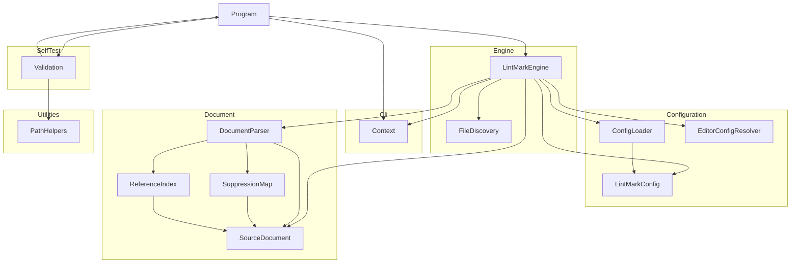

# LintMark

## Architecture

The LintMark is a command-line application built on .NET. It is structured as one
system containing one top-level unit (`Program`) and six subsystems (`Cli`, `Configuration`, `Document`,
`Engine`, `SelfTest`, `Utilities`):

`Program` is the entry point. It creates a `Context` from the `Cli` subsystem, dispatches to
`Validation` when `--validate` is passed, hands the file processing to `LintMarkEngine` from the
`Engine` subsystem otherwise, and returns the exit code from `Context`. `Validation` calls
`Program.Run` recursively to exercise the tool during self-testing, and uses `PathHelpers` to
construct safe temporary file paths.

`LintMarkEngine` asks `FileDiscovery` to turn the positional path arguments of the `Context` into
a list of Markdown files. It then processes the files in parallel: each worker reads a file, builds
a `SourceDocument` (decoding and line-ending normalization) and passes it to `DocumentParser` from
the `Document` subsystem, which parses it with the Markdig library and also produces the
`SuppressionMap` and `ReferenceIndex` of the document. Each worker then determines the effective
configuration of the file with the `Configuration` subsystem: the `ConfigLoader` supplies the
`LintMarkConfig` from the `.lintmark.yaml` file that applies to the file (or the built-in defaults), and the
`EditorConfigResolver` supplies the line ending from the `.editorconfig` settings when the configuration gives
none. `ConfigLoader` reads the YAML with the YamlDotNet library; `EditorConfigResolver` reads the editor
settings with the EditorConfig library. After all workers have finished, the engine merges the failures and the
distinct configuration problems, sorts them, and writes them to the `Context` from a single thread. The diagram
shows calls: `SuppressionMap` and `ReferenceIndex` also read the `BlockInfo` and `BlockKind` types declared with
`DocumentParser`, a cycle of types only (see *Document Design*). `ConfigLoader` and `LintMarkConfig` also use the
`LineEnding` type of the `Document` subsystem, which is not drawn.

Linting rules and formatting are not part of this phase: the tool currently reads and parses files, determines
the configuration of each file, and reports the files it cannot process and the configuration problems it
finds. The configuration it determines is not yet used to lint or format.

## External Interfaces

**Command-Line Interface**: The primary input interface for tool invocation.

- *Type*: CLI.
- *Role*: Consumer (the host environment invokes the system with command-line arguments).
- *Contract*: Accepts arguments `-v`/`--version`, `-?`/`-h`/`--help`, `--silent`, `--validate`,
  `--results <file>`, `--result <file>` (legacy alias for `--results`), `--depth <n>`, `--log <file>`,
  `--check`, `--config <file>`, `--no-config`, and any number of positional path arguments. A positional
  argument is any argument that
  does not start with a dash: an existing file, an existing directory (every `*.md` file beneath
  it), or a glob pattern using `*` and `**` (either path separator; relative, parent-relative, or
  absolute). A pattern starting with `!` excludes the files it matches. With no path argument,
  `**/*.md` under the current directory is used; a list of only exclusions removes files from
  that default. Directory, glob, and default expansion never select files from `node_modules` or
  `.git` folders, whether the folder is found beneath the searched directory or is named by an argument
  (or by the leading, wildcard-free part of a glob); only a file named explicitly is accepted from such a
  folder (unless a `!` pattern excludes it). A pattern that matches nothing is not an error. `--check` is an
  explicit statement of the default behavior (nothing is ever written in this phase). `--config <file>` names
  the configuration file to use instead of discovering one (relative to the current directory; either path
  separator; repeated: the last one wins), and `--no-config` ignores both `.lintmark.yaml` and `.editorconfig`
  and uses the built-in defaults. `--validate` combined with a path, `--check`, `--config`, or `--no-config` is
  rejected, and so is `--config` combined with `--no-config`. Returns exit code 0 for success and 1 for
  failures.
- *Constraints*: Unknown dash-leading arguments (including a lone `-` and an empty argument) cause
  exit code 1 and an error message on stderr, and so does `--config` with a missing or blank filename. A literal
  path that does not exist is passed through and reported as a read failure.

**Standard Output**: Normal program output written to `Console.Out`.

- *Type*: Standard I/O.
- *Role*: Provider.
- *Contract*: Writes version, banner, help text, validation summary, or tool status message depending
  on the flags provided. Suppressed when `--silent` is active; the log file still receives all
  output. File processing writes nothing to standard output on success.
- *Constraints*: Human-readable text; no machine-parseable format contract.

**Standard Error**: Error message output written to `Console.Error`.

- *Type*: Standard I/O.
- *Role*: Provider.
- *Contract*: Writes error messages in red when a failure occurs. Suppressed when `--silent`
  is active but the exit code is still set to 1. Each file that cannot be processed and each configuration
  problem is reported on its own line as `display-path:line:col: rule-id message`, where `display-path` is
  relative to the current directory with `/` separators (it may start with `../` for a configuration file
  outside the current directory) and line and column are 1-based (a column counts UTF-16 code
  units and a tab counts as one). The rule identifiers are `file-read-error`, `file-encoding-error`,
  `file-line-ending-error`, `file-parse-error`, and `config-error`. A file failure is reported against the
  Markdown file. A `config-error` is reported against the configuration file at the position of the problem,
  or against the Markdown file at 1:1 when the `.editorconfig` settings that apply to it cannot be read. The same
  configuration problem reached through many Markdown files is reported once. All lines are merged and ordered
  by display path (ordinal), then line, column, rule identifier (ordinal), and message (ordinal). There is no
  summary line.
- *Constraints*: Color output requires a terminal that supports `ConsoleColor`.

**Log File**: Optional persistent output file.

- *Type*: File.
- *Role*: Provider.
- *Contract*: When `--log <file>` is supplied, all `Context.WriteLine` and `Context.WriteError`
  output is written to the log regardless of `--silent`. `Context.Create` opens the log file for writing, so an
  existing file at that path is truncated, exactly as in the other DEMA Consulting tools; the lines are written
  as they are produced, and `Context.Dispose` closes the file.
- *Constraints*: A log file that cannot be opened (an invalid path, a directory, a missing directory, or access
  denied) raises an `InvalidOperationException` when the arguments are parsed, which causes exit code 1.

**Results File**: Optional self-validation results file.

- *Type*: File.
- *Role*: Provider.
- *Contract*: When `--results <file>` is supplied alongside `--validate`, self-validation results
  are serialized to the file. Extension `.trx` selects MSTest TRX format; `.xml` selects JUnit
  XML format.
- *Constraints*: Any other extension causes an error message and exit code 1; no file is written.

**Configuration File**: Optional `.lintmark.yaml` input.

- *Type*: File.
- *Role*: Consumer.
- *Contract*: For each Markdown file the nearest `.lintmark.yaml` is used: the search starts in the directory of
  the file and walks upward through the parent directories, and stops after the first directory that contains a
  `.git` entry (a directory or a file), which is the repository root and is itself searched. The nearest file
  wins and files are never merged. `--config <file>` replaces the search with one named file and `--no-config`
  disables configuration files. The file is UTF-8 YAML (a byte order mark is accepted, CRLF is accepted) of at
  most 1 MiB with a fixed schema (see *ConfigLoader Design*). Each file is read once per run.
- *Constraints*: An invalid file is not used: every problem is reported as a `config-error` with its position
  and the exit code is 1, while the Markdown files it would have applied to are still read and parsed. A
  missing or unreadable file named with `--config` is a `config-error` at 1:1, reported even when no
  Markdown file is selected. A file that is not reached because a nearer file exists is never read.

**Editor Settings**: Optional `.editorconfig` input.

- *Type*: File.
- *Role*: Consumer.
- *Contract*: Only `end_of_line` is read, for each Markdown file whose configuration does not specify
  `end-of-line`; `lf` and `crlf` are understood and every other value or a missing property means "not
  specified". `.editorconfig` files are located and evaluated by the EditorConfig library (nearest file wins,
  `root = true` ends the search, later sections win, section patterns are case-sensitive). They are ignored when
  `--no-config` is given; `--config` does not disable them.
- *Constraints*: Malformed content is never an error. Editor settings that cannot be read are a `config-error`
  against the Markdown file at 1:1 and exit code 1.

## Dependencies

- **Markdig**: parses Markdown into a syntax tree with source ranges (used by the `Document`
  subsystem). See *Markdig Integration Design* in the OTS design documents.
- **Microsoft.Extensions.FileSystemGlobbing** (FileSystemGlobbing): expands and applies glob patterns
  (used by `FileDiscovery`). See *FileSystemGlobbing Integration Design* in the OTS design documents.
- **YamlDotNet**: reads the YAML syntax of `.lintmark.yaml` files at event level (used by `ConfigLoader`). See
  *YamlDotNet Integration Design* in the OTS design documents.
- **EditorConfig** (the `editorconfig` package): finds and evaluates `.editorconfig` files (used by
  `EditorConfigResolver`). It brings the file-system abstraction package `System.IO.Abstractions` as a
  transitive dependency. See *EditorConfig Integration Design* in the OTS design documents.
- **DemaConsulting.TestResults**: provides `TestResults`, `TestResult`, and `TestOutcome` for
  accumulating self-validation results.
- **DemaConsulting.TestResults.IO**: provides `TrxSerializer` and `JUnitSerializer` for writing
  results files.

## Risk Control Measures

N/A - not a safety-classified software item.

## Data Flow

1. The host environment starts the tool process and passes command-line arguments to
   `Program.Main`.
2. `Program.Main` calls `Context.Create(args)`, which parses the arguments and opens the log file
   if `--log` was specified. An `ArgumentException` or
   `InvalidOperationException` at this point (including `--validate` combined with a path,
   `--check`, `--config`, or `--no-config`, `--config` combined with `--no-config`, and `--config` without a
   filename; the combinations are rejected before the log file is opened) is caught, written to stderr, and
   causes exit code 1.
3. `Program.Run(context)` inspects the parsed flags and dispatches to one handler:
   - `--version` flag → `context.WriteLine(Version)`, then return.
   - Otherwise `PrintBanner` is called; then:
     - `--help` flag → `PrintHelp(context)`, then return.
     - `--validate` flag → `Validation.Run(context)`.
     - Otherwise → `LintMarkEngine.Run(context)`.
4. `LintMarkEngine.Run` passes `context.Paths` and the current directory to
   `FileDiscovery.Discover`, which returns distinct full paths in ordinal order.
5. `LintMarkEngine.Run` selects the configuration sources from the command line: with `--no-config` a
   defaults-only `ConfigLoader` and no `EditorConfigResolver` (so nothing is probed); with `--config <file>` a
   `ConfigLoader` for that file, which is read once at that point; otherwise a discovering `ConfigLoader`. Unless
   `--no-config` was given, an `EditorConfigResolver` is created.
6. `LintMarkEngine.Process` reads and parses the files in parallel. For each file a worker reads the
   bytes, creates a `SourceDocument` (strict UTF-8 decoding, byte order mark detection, CRLF to LF
   normalization), and calls `DocumentParser.Parse`. A read, encoding, line-ending, or parser failure
   becomes a failure entry for that file only. The worker then determines the effective configuration of the
   file: `ConfigLoader.Load` returns the `LintMarkConfig` of the nearest `.lintmark.yaml` (or the defaults), and when
   its `EndOfLine` is not set the `EditorConfigResolver` supplies `end_of_line`, which is copied into the file's
   configuration. If the configuration is invalid, the file has no configuration and carries the problems; its own
   failures are kept. Results are stored by input index, then sorted by path.
7. After all workers have finished, `LintMarkEngine.Run` combines the failures with the distinct configuration
   problems (those of the files and the initial problems of an explicit `--config` file), converts each path to its
   display form, sorts all lines by display path, line, column, rule identifier, and message, and writes each one
   through `context.WriteError` from the calling thread. Every configuration problem makes the exit code 1.
8. `Program.Main` returns `context.ExitCode` (0 if no errors were reported, 1 otherwise).

## Design Constraints

- Platform: multi-targets net10.0 and net11.0 framework compatibility specifications on Windows, Linux, and macOS.
- Threading: files are processed in parallel by `LintMarkEngine` with a limit set through the
  engine constructor (not a user option) that defaults to the processor count. The following rules keep
  the result independent of scheduling:
  - `Parallel.For` bounded by the limit; each worker handles whole files and writes only its own
    result slot (results are addressed by input index).
  - Workers never touch `Context` and never write output; failures and configuration problems are emitted
    sequentially after all workers have finished, in one merged deterministic order (display path, line,
    column, rule identifier, message). A configuration problem shared by many files is reported once.
  - The state shared by workers is immutable or built for sharing: the Markdown pipeline built once by
    `DocumentParser`, the immutable `LintMarkConfig` instances, and the two configuration caches. The
    `ConfigLoader` caches (per start directory and per configuration file) and the `EditorConfigResolver`
    cache (per directory) are `ConcurrentDictionary` instances of `Lazy` values with
    `ExecutionAndPublication` thread safety, so concurrent workers share one computation and always
    receive the same immutable result; results are pure functions of the file-system content and do not
    depend on scheduling. All per-file objects (`SourceDocument`, syntax tree, `SuppressionMap`,
    `ReferenceIndex`) belong to one worker.
  - Configuration content is read once per run: edits to `.lintmark.yaml` or `.editorconfig` made while the run
    is in progress are not seen.
  - `Context` serializes `WriteLine`, `WriteError`, `Dispose` and the read of `ExitCode` with a
    `System.Threading.Lock`, as a defensive measure for any caller that writes concurrently.
- Immutability: `Context` properties are set once at construction via `init` accessors and are
  read-only thereafter. Collections that a unit exposes through a read-only interface (`Context.Paths`,
  `SourceDocument.LineStarts`, `SuppressionMap.Ranges`, `RuleSet.Rules`, `ReferenceIndex.Definitions`,
  `ParsedDocument.Blocks`, `FileResult.Failures`) are backed by immutable collections, so a caller
  cannot change them by casting to a mutable type. The same holds for `LintMarkConfig.Rules` and
  `LintMarkConfig.Ignore`, `ConfigLoadResult.Errors`, and `FileResult.ConfigErrors`, and `LintMarkConfig` is
  deeply immutable with validating `init` accessors, so an effective configuration derived with a `with`
  expression never changes a shared instance.
- Resource lifecycle: `Context` implements `IDisposable`; callers must dispose it to close the log file handle.
- Path safety: all caller-supplied path components are validated by `PathHelpers.SafePathCombine`
  before file-system use by self-validation. Files named on the command line are only read, never
  written. Configuration and editor settings files are only read, never written; every path is made
  absolute with `\` converted to `/` before it is used for a file-system check.
- Input handling: only UTF-8 text with LF or CRLF line terminators is supported; other input is
  reported as a failure instead of being repaired. A configuration file must be UTF-8 and at most 1 MiB.
- Line-ending configuration: the configuration key for the line-ending style is `end-of-line` (`lf` or
  `crlf`). The line ending of a file's effective configuration is chosen by precedence: the `end-of-line` setting
  of the configuration file, then `end_of_line` from the `.editorconfig` settings, then not specified (the
  file's own majority line ending is applied later, when formatting exists). `--no-config` ignores both sources;
  `--config` replaces only the discovery of `.lintmark.yaml` and does not disable `.editorconfig`. The line ending
  is stored but not consumed before the formatter exists, so it cannot be observed from outside the tool in this
  phase; the formatting phase adds the system requirement that the tool uses it, and until then only the
  tolerance of editor settings that cannot be used is a system requirement.
- Configuration scope: the `ignore` setting is validated and stored, but the engine does not apply it yet, and no
  setting other than the line ending changes behavior until linting and formatting are added.
