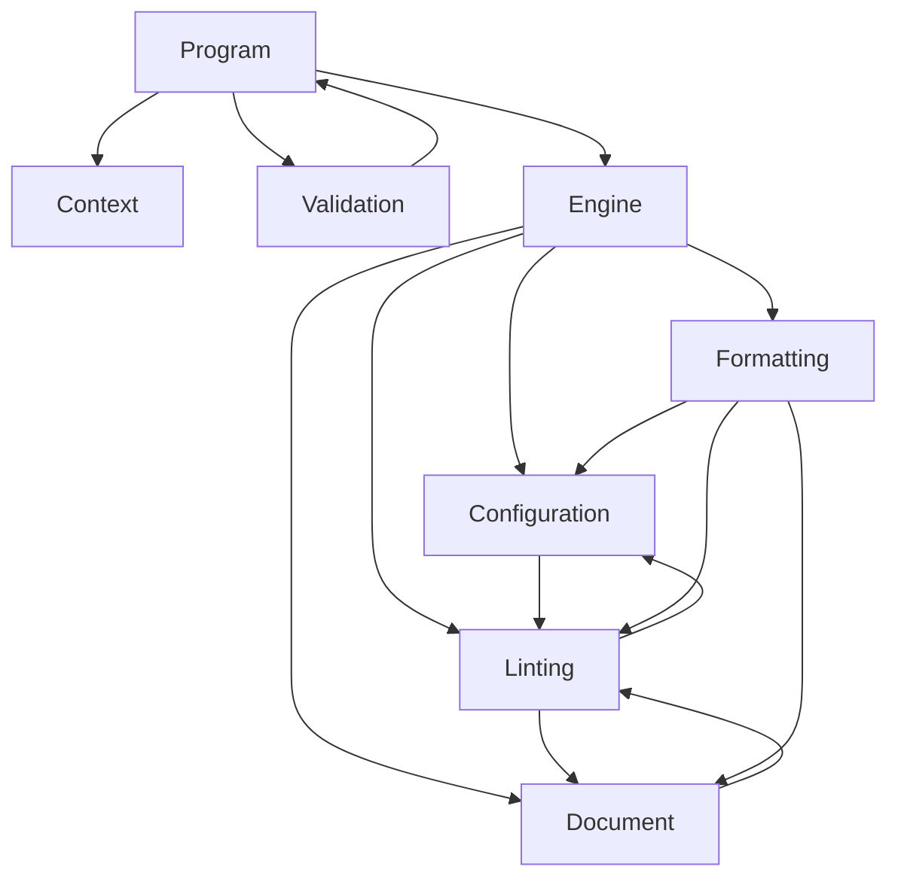

# LintMark


## Architecture

LintMark is a .NET command-line tool (command `lintmark`, packaged as a .NET tool) that lints Markdown files and, on
request, rewrites them into a canonical form. The system consists of three units that sit directly under it and five
subsystems:

- `Program` (unit): the entry point; dispatches version, help, self-validation, or a linting run.
- `Context` (unit): parses the command line and owns all console and log output and the exit code.
- `Validation` (unit): the built-in self-validation (`--validate`).
- `Configuration` (subsystem): the settings model, `.lintmark.yaml` loading, and `.editorconfig` resolution.
- `Document` (subsystem): decoding, parsing, suppression comments, and text-width measurement.
- `Linting` (subsystem): the rule registry, the diagnostic model, and the lint-only rules.
- `Formatting` (subsystem, with the nested subsystems `Blocks` and `Inline`): the canonical form; produces edits.
- `Engine` (subsystem): file discovery, the per-file pipeline, parallelism, atomic writing, and reporting.



Design principle: a document is never modified in place while it is analyzed. The `Formatting` subsystem and the
lint rules only produce edits and diagnostics for an immutable parsed document; the `Engine` composes the edits into
new text and is the only place that writes a file. Each file is processed independently, so files can run in
parallel. Subsystem relationships are detailed in the subsystem designs; see *Engine Design* for the orchestration.

## External Interfaces

- **Command line** (in): `lintmark [options] [paths...]`. A path is a file, directory, glob, or `!` exclude. Options:
  `-v/--version`, `-?/-h/--help`, `--check` (default), `--fix`, `--diff`, `--config <file>`, `--no-config`,
  `--enable <ids>`, `--disable <ids>`, `--silent`, `--validate`, `--results <file>`, `--depth <n>`, and
  `--log <file>`. Contradictory combinations are rejected (see *Context Design*).
- **`.lintmark.yaml`** (in): a YAML mapping of settings and `rules`. The nearest file above each Markdown file is
  used and files are never merged. Unknown keys and invalid values are reported as problems with line and column (see
  *ConfigLoader Design*).
- **`.editorconfig`** (in): read only for the line ending (`end_of_line`) when the configuration does not set
  `end-of-line`; ignored with `--no-config`.
- **Markdown files** (in and out): read as UTF-8 bytes; rewritten only with `--fix`, by an atomic replace.
- **Standard error** (out): findings as `path:line:col: rule-id message`, ordered by path, line, column, rule, and
  message.
- **Standard output** (out): banner, help, version, the `--diff` unified diff, and the self-validation report;
  suppressed by `--silent`.
- **Log file** (out): `--log <file>` receives the same lines as the console.
- **Results file** (out): `--results <file>` receives the self-validation results as TRX (`.trx`) or JUnit (`.xml`).
- **Exit code** (out): 0 when no finding, problem, or error was reported, 1 otherwise. No other value is produced.

Rule identifiers are kebab-case names with legacy rule-number aliases (such as `MD013`) accepted wherever a rule is named.

## Dependencies

Runtime OTS items consumed by the shipped tool:

- Markdig: Markdown parsing (see the *Markdig* OTS design).
- FileSystemGlobbing: glob matching for path arguments and `ignore` (see *FileSystemGlobbing*).
- YamlDotNet: event-level reading of `.lintmark.yaml` (see *YamlDotNet*).
- EditorConfig: `.editorconfig` resolution (see *EditorConfig*).
- TestResults: TRX and JUnit writing for self-validation (see *TestResults*).

Build-time and pipeline tools are described in *OTS Software Integration Design*. The local items depend on each
other as described in the subsystem and unit designs.

## Risk Control Measures

N/A - no segregation is required for risk control; the system is a development tool and no IEC 62304 safety
classification applies. The safeguards that exist are design measures:

- Rewrites are applied atomically (temporary file, then replace) and only when the resulting bytes differ from the file,
  so a failed write never leaves a partial file and a clean file is never touched.
- A document that the parser could only read by dropping grid tables is format-unsafe and is never rewritten.
- Symbolic links are resolved before reading and writing, so a link is not replaced by a regular file.
- Formatting is deterministic and works on edits that cannot overlap; invalid edits fail the one file, not the run.
- Correctness of rewrites (structure preserved, rendered output equivalent, idempotent result) is not proven at run
  time and the tool contains no runtime proof or re-check step. It is verified at development time by the corpus
  harness `tools/LintMark.Verify`, a non-shipping development tool (see the verification documents).

## Data Flow

```text
arguments --> Context --> Program --> Engine
Engine: discover files (FileDiscovery)
  per file, in parallel:
    configuration (nearest .lintmark.yaml, or --config / defaults) + .editorconfig line ending
    read bytes --> decode --> parse (SourceDocument, DocumentParser, SuppressionMap)
    lint rules (LintRuleEngine) --> diagnostics
    format (DocumentFormatter) --> edits and formatting diagnostics
    compose edits (EditSet, SourcePatcher) --> new text --> bytes
  merge results in path order
  --fix: write changed files atomically (AtomicFileWriter); remaining findings re-linted on the new text
  report (TextReporter; DiffReporter with --diff) --> console, log file --> exit code
```

## Design Constraints

- Platforms: .NET 10 and .NET 11 (`net10.0`, `net11.0`); Windows, Linux, and macOS with identical results.
- Performance: processing time is linear in document size; edit composition uses an offset rebase that avoids
  quadratic behavior; input limits guard configuration parsing.
- Determinism: output ordering and rewrite results do not depend on thread scheduling or the machine; formatting is
  idempotent.
- Encoding: UTF-8 input and output; a byte order mark and the dominant line ending are preserved unless configured.
- Security: no network access; files are only read and written within the paths selected by the user.
- Side effects: a run without `--fix` writes no Markdown file.
