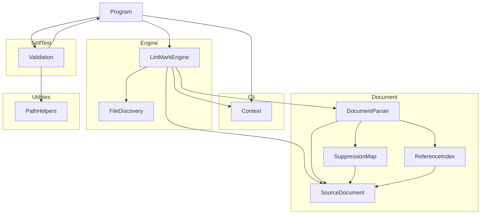

# LintMark

## Architecture

The LintMark is a command-line application built on .NET. It is structured as one
system containing one top-level unit (`Program`) and five subsystems (`Cli`, `Document`, `Engine`,
`SelfTest`, `Utilities`):

`Program` is the entry point. It creates a `Context` from the `Cli` subsystem, dispatches to
`Validation` when `--validate` is passed, hands the file processing to `LintMarkEngine` from the
`Engine` subsystem otherwise, and returns the exit code from `Context`. `Validation` calls
`Program.Run` recursively to exercise the tool during self-testing, and uses `PathHelpers` to
construct safe temporary file paths.

`LintMarkEngine` asks `FileDiscovery` to turn the positional path arguments of the `Context` into
a list of Markdown files. It then processes the files in parallel: each worker reads a file, builds
a `SourceDocument` (decoding and line-ending normalization) and passes it to `DocumentParser` from
the `Document` subsystem, which parses it with the Markdig library and also produces the
`SuppressionMap` and `ReferenceIndex` of the document. After all workers have finished, the engine
sorts the results and writes the failures to the `Context` from a single thread. The diagram shows
calls: `SuppressionMap` and `ReferenceIndex` also read the `BlockInfo` and `BlockKind` types declared with
`DocumentParser`, a cycle of types only (see *Document Design*).

Linting rules, formatting, and configuration are not part of this phase: the tool currently
reads and parses files and reports the files it cannot process.

## External Interfaces

**Command-Line Interface**: The primary input interface for tool invocation.

- *Type*: CLI.
- *Role*: Consumer (the host environment invokes the system with command-line arguments).
- *Contract*: Accepts arguments `-v`/`--version`, `-?`/`-h`/`--help`, `--silent`, `--validate`,
  `--results <file>`, `--result <file>` (legacy alias for `--results`), `--depth <n>`, `--log <file>`,
  `--check`, and any number of positional path arguments. A positional argument is any argument that
  does not start with a dash: an existing file, an existing directory (every `*.md` file beneath
  it), or a glob pattern using `*` and `**` (either path separator; relative, parent-relative, or
  absolute). A pattern starting with `!` excludes the files it matches. With no path argument,
  `**/*.md` under the current directory is used; a list of only exclusions removes files from
  that default. Directory, glob, and default expansion never select files from `node_modules` or
  `.git` folders, whether the folder is found beneath the searched directory or is named by an argument
  (or by the leading, wildcard-free part of a glob); only a file named explicitly is accepted from such a
  folder (unless a `!` pattern excludes it). A pattern that matches nothing is not an error. `--check` is an
  explicit statement of the default behavior (nothing is ever written in this phase). `--validate`
  combined with a path or `--check` is rejected. Returns exit code 0 for success and 1 for
  failures.
- *Constraints*: Unknown dash-leading arguments (including a lone `-` and an empty argument) cause
  exit code 1 and an error message on stderr. A literal path that does not exist is passed
  through and reported as a read failure.

**Standard Output**: Normal program output written to `Console.Out`.

- *Type*: Standard I/O.
- *Role*: Provider.
- *Contract*: Writes version, banner, help text, validation summary, or tool status message depending
  on the flags provided. Suppressed when `--silent` is active; the log file still receives all
  output. File processing writes nothing to standard output on success.
- *Constraints*: Human-readable text; no machine-parseable format contract.

**Standard Error**: Error message output written to `Console.Error`.

- *Type*: Standard I/O.
- *Role*: Provider.
- *Contract*: Writes error messages in red when a failure occurs. Suppressed when `--silent`
  is active but the exit code is still set to 1. Each file that cannot be processed is reported on
  its own line as `display-path:line:col: rule-id message`, where `display-path` is relative to the
  current directory with `/` separators and line and column are 1-based (a column counts UTF-16 code
  units and a tab counts as one). The rule identifiers are `file-read-error`, `file-encoding-error`,
  `file-line-ending-error`, and `file-parse-error`. Lines are ordered by display path (ordinal), then
  line, column, and rule identifier. There is no summary line.
- *Constraints*: Color output requires a terminal that supports `ConsoleColor`.

**Log File**: Optional persistent output file.

- *Type*: File.
- *Role*: Provider.
- *Contract*: When `--log <file>` is supplied, all `Context.WriteLine` and `Context.WriteError`
  output is written to the log regardless of `--silent`. `Context.Create` opens the log file for writing, so an
  existing file at that path is truncated, exactly as in the other DEMA Consulting tools; the lines are written
  as they are produced, and `Context.Dispose` closes the file.
- *Constraints*: A log file that cannot be opened (an invalid path, a directory, a missing directory, or access
  denied) raises an `InvalidOperationException` when the arguments are parsed, which causes exit code 1.

**Results File**: Optional self-validation results file.

- *Type*: File.
- *Role*: Provider.
- *Contract*: When `--results <file>` is supplied alongside `--validate`, self-validation results
  are serialized to the file. Extension `.trx` selects MSTest TRX format; `.xml` selects JUnit
  XML format.
- *Constraints*: Any other extension causes an error message and exit code 1; no file is written.

## Dependencies

- **Markdig**: parses Markdown into a syntax tree with source ranges (used by the `Document`
  subsystem). See *Markdig Integration Design* in the OTS design documents.
- **Microsoft.Extensions.FileSystemGlobbing** (FileSystemGlobbing): expands and applies glob patterns
  (used by `FileDiscovery`). See *FileSystemGlobbing Integration Design* in the OTS design documents.
- **DemaConsulting.TestResults**: provides `TestResults`, `TestResult`, and `TestOutcome` for
  accumulating self-validation results.
- **DemaConsulting.TestResults.IO**: provides `TrxSerializer` and `JUnitSerializer` for writing
  results files.

## Risk Control Measures

N/A - not a safety-classified software item.

## Data Flow

1. The host environment starts the tool process and passes command-line arguments to
   `Program.Main`.
2. `Program.Main` calls `Context.Create(args)`, which parses the arguments and opens the log file
   if `--log` was specified. An `ArgumentException` or
   `InvalidOperationException` at this point (including `--validate` combined with a path or
   `--check`, which is rejected before the log file is opened) is caught, written to stderr, and
   causes exit code 1.
3. `Program.Run(context)` inspects the parsed flags and dispatches to one handler:
   - `--version` flag → `context.WriteLine(Version)`, then return.
   - Otherwise `PrintBanner` is called; then:
     - `--help` flag → `PrintHelp(context)`, then return.
     - `--validate` flag → `Validation.Run(context)`.
     - Otherwise → `LintMarkEngine.Run(context)`.
4. `LintMarkEngine.Run` passes `context.Paths` and the current directory to
   `FileDiscovery.Discover`, which returns distinct full paths in ordinal order.
5. `LintMarkEngine.Process` reads and parses the files in parallel. For each file a worker reads the
   bytes, creates a `SourceDocument` (strict UTF-8 decoding, byte order mark detection, CRLF to LF
   normalization), and calls `DocumentParser.Parse`. A read, encoding, line-ending, or parser failure
   becomes a failure entry for that file only. Results are stored by input index, then sorted by path.
6. After all workers have finished, `LintMarkEngine.Run` converts each path to its display form,
   sorts by display path, and writes every failure through `context.WriteError` from the calling
   thread.
7. `Program.Main` returns `context.ExitCode` (0 if no errors were reported, 1 otherwise).

## Design Constraints

- Platform: multi-targets net10.0 and net11.0 framework compatibility specifications on Windows, Linux, and macOS.
- Threading: files are processed in parallel by `LintMarkEngine` with a limit set through the
  engine constructor (not a user option) that defaults to the processor count. The following rules keep
  the result independent of scheduling:
  - `Parallel.For` bounded by the limit; each worker handles whole files and writes only its own
    result slot (results are addressed by input index).
  - Workers never touch `Context` and never write output; failures are emitted sequentially after
    all workers have finished, in display-path order.
  - The only state shared by workers is immutable: the Markdown pipeline built once by
    `DocumentParser`. All per-file objects (`SourceDocument`, syntax tree, `SuppressionMap`,
    `ReferenceIndex`) belong to one worker.
  - `Context` serializes `WriteLine`, `WriteError`, `Dispose` and the read of `ExitCode` with a
    `System.Threading.Lock`, as a defensive measure for any caller that writes concurrently.
- Immutability: `Context` properties are set once at construction via `init` accessors and are
  read-only thereafter. Collections that a unit exposes through a read-only interface (`Context.Paths`,
  `SourceDocument.LineStarts`, `SuppressionMap.Ranges`, `RuleSet.Rules`, `ReferenceIndex.Definitions`,
  `ParsedDocument.Blocks`, `FileResult.Failures`) are backed by immutable collections, so a caller
  cannot change them by casting to a mutable type.
- Resource lifecycle: `Context` implements `IDisposable`; callers must dispose it to close the log file handle.
- Path safety: all caller-supplied path components are validated by `PathHelpers.SafePathCombine`
  before file-system use by self-validation. Files named on the command line are only read, never
  written.
- Input handling: only UTF-8 text with LF or CRLF line terminators is supported; other input is
  reported as a failure instead of being repaired.
- Planned configuration behavior (design intent for a later phase, not a current capability): the
  configuration key for the line-ending style will be `end-of-line`, and `--no-config` will also
  ignore `.editorconfig` settings.
