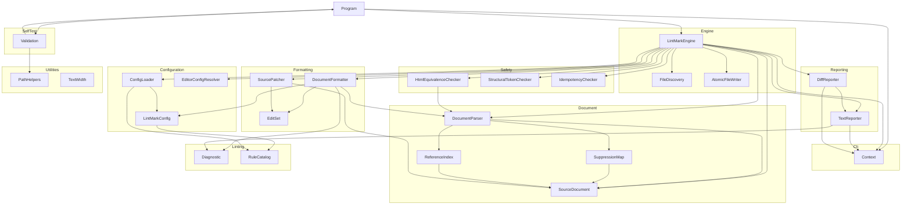
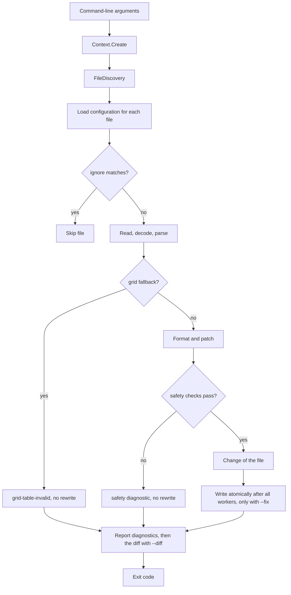

# LintMark

## Architecture

The LintMark is a command-line application built on .NET. It is structured as one
system containing one top-level unit (`Program`) and ten subsystems (`Cli`, `Configuration`, `Document`, `Engine`,
`Formatting`, `Linting`, `Reporting`, `Safety`, `SelfTest`, `Utilities`):

`Program` is the entry point. It creates a `Context` from the `Cli` subsystem, dispatches to
`Validation` when `--validate` is passed, hands the file processing to `LintMarkEngine` from the
`Engine` subsystem otherwise, and returns the exit code from `Context`. `Validation` calls
`Program.Run` recursively to exercise the tool during self-testing, and uses `PathHelpers` to
construct safe temporary file paths.

`LintMarkEngine` asks `FileDiscovery` to turn the positional path arguments of the `Context` into
a list of Markdown files, each marked as named on the command line or not. It then processes the files in parallel,
and for each file the configuration comes first: the `ConfigLoader` supplies the `LintMarkConfig` from the
`.lintmark.yaml` file that applies to the file (or the built-in defaults), and the `EditorConfigResolver` supplies the
line ending from the `.editorconfig` settings when the configuration gives none. `ConfigLoader` reads the YAML with the
YamlDotNet library; `EditorConfigResolver` reads the editor settings with the EditorConfig library. The `ignore`
patterns of the configuration can skip the file, through `FileDiscovery`, before it is read. Otherwise the worker reads
the file, builds a `SourceDocument` (decoding and line-ending normalization) and passes it to `DocumentParser` from the
`Document` subsystem, which parses it with the Markdig library and also produces the `SuppressionMap` and
`ReferenceIndex` of the document. The `DocumentFormatter` of the `Formatting` subsystem turns the parsed document into
a proposal (text edits and a line ending, collected in an `EditSet`), and `SourcePatcher` applies the edits to the text.
When the text would change, the three checkers of the `Safety` subsystem verify the proposal: the rendered HTML must be
unchanged (`HtmlEquivalenceChecker`, which renders with Markdig and the pipeline of `DocumentParser`), the Pandoc
structure must be unchanged (`StructuralTokenChecker`), and formatting the result again must change nothing
(`IdempotencyChecker`). Only a proposal that passes becomes a change of the file. After all workers have finished, the
engine writes the changes one after the other with `AtomicFileWriter` when `--fix` is given, and hands every finding,
as a `Diagnostic` of the `Linting` subsystem, to the `Reporting` subsystem: `TextReporter` writes the findings to
standard error in a deterministic order and, with `--diff`, `DiffReporter` writes a unified diff of the proposed
changes to standard output. The `Linting` subsystem also holds the `RuleCatalog`, the registry of rule identifiers that
`LintMarkConfig` and `ConfigLoader` validate the `rules` setting against.

The diagram shows calls. `SuppressionMap` and `ReferenceIndex` also read the `BlockInfo` and `BlockKind` types declared
with `DocumentParser`, a cycle of types only (see *Document Design*). `ConfigLoader`, `LintMarkConfig`,
`DocumentFormatter`, `SourcePatcher`, and `DiffReporter` also use the `LineEnding` type (and `DiffReporter` the
`LineEndingInfo` type) of the `Document` subsystem, which is not drawn. At subsystem level, `Configuration` consumes
`Linting` (the `RuleCatalog`); a later phase will add lint rules to `Linting` that consume `LintMarkConfig`, which
makes the two subsystems depend on each other while the unit level stays acyclic (see *Linting Design*). The block
formatters that `DocumentFormatter` calls, and the lint rules, do not exist yet: the tool currently
normalizes line endings (the only change a formatter makes without block formatters) and verifies every rewrite, and
the settings other than the line ending, the `ignore` patterns, and the `rules` entry for grid tables do not yet change
its behavior.

## External Interfaces

**Command-Line Interface**: The primary input interface for tool invocation.

- *Type*: CLI.
- *Role*: Consumer (the host environment invokes the system with command-line arguments).
- *Contract*: Accepts arguments `-v`/`--version`, `-?`/`-h`/`--help`, `--silent`, `--validate`,
  `--results <file>`, `--result <file>` (legacy alias for `--results`), `--depth <n>`, `--log <file>`,
  `--check`, `--fix`, `--diff`, `--config <file>`, `--no-config`, and any number of positional path arguments. A
  positional argument is any argument that
  does not start with a dash: an existing file, an existing directory (every `*.md` file beneath
  it), or a glob pattern using `*` and `**` (either path separator; relative, parent-relative, or
  absolute). A pattern starting with `!` excludes the files it matches. With no path argument,
  `**/*.md` under the current directory is used; a list of only exclusions removes files from
  that default. Directory, glob, and default expansion never select files from `node_modules` or
  `.git` folders, whether the folder is found beneath the searched directory or is named by an argument
  (or by the leading, wildcard-free part of a glob); only a file named explicitly is accepted from such a
  folder (unless a `!` pattern excludes it). A pattern that matches nothing is not an error. The mode options are:
  `--check` reports problems and writes no file (the default, so the option is an explicit statement of it); `--fix`
  rewrites each file that needs it into canonical form, but only when every safety check passes (see *Risk Control
  Measures*), and reports the problems that remain; `--diff` prints a unified diff of what `--fix` would change and
  writes no file. `--fix` cannot be combined with `--check` or `--diff`; `--diff` may be combined with `--check`.
  `--config <file>` names
  the configuration file to use instead of discovering one (relative to the current directory; either path
  separator; repeated: the last one wins), and `--no-config` ignores both `.lintmark.yaml` and `.editorconfig`
  and uses the built-in defaults. `--validate` combined with a path, `--check`, `--fix`, `--diff`, `--config`, or
  `--no-config` is rejected, and so is `--config` combined with `--no-config`. Returns exit code 0 for success and 1 for
  failures.
- *Constraints*: Unknown dash-leading arguments (including a lone `-` and an empty argument) cause
  exit code 1 and an error message on stderr, and so does `--config` with a missing or blank filename. A literal
  path that does not exist is passed through and reported as a read failure.
- *Ignore semantics*: The `ignore` patterns of the configuration that applies to a file skip it: it is not read,
  reported, or rewritten. A pattern is a glob relative to the directory of that configuration file (the current
  directory when the built-in defaults apply), and a file outside that directory is never ignored. Ignore applies only
  to files found through a directory, a glob, or the default pattern. A file named explicitly on the command line (an
  existing file or a path without wildcards) is never ignored, the same rule that accepts it from `node_modules` or
  `.git`; only a `!` pattern on the command line removes it. When the configuration of a file is invalid, its `ignore`
  patterns are unknown, so the file is processed (its read and parse failures are still reported) but never rewritten.

**Standard Output**: Normal program output written to `Console.Out`.

- *Type*: Standard I/O.
- *Role*: Provider.
- *Contract*: Writes version, banner, help text, validation summary, or tool status message depending
  on the flags provided. With `--diff` it also writes the unified diff of the proposed changes: for each changed file
  the headers `--- a/path` and `+++ b/path`, hunks with three lines of context, `\ No newline at end of file` markers,
  and, when only the line endings would change, a note line `\ Line endings change from X to Y`. Suppressed when
  `--silent` is active; the log file still receives all output. File processing writes nothing to standard output on
  success or without `--diff`.
- *Constraints*: Human-readable text; the diff follows the unified diff format that patch tools understand and its
  order is deterministic (display path order), but there is no other machine-parseable format contract.

**Standard Error**: Error message output written to `Console.Error`.

- *Type*: Standard I/O.
- *Role*: Provider.
- *Contract*: Writes error messages in red when a failure occurs. Suppressed when `--silent`
  is active but the exit code is still set to 1. Every diagnostic is reported on its own line as
  `display-path:line:col: rule-id message`, where `display-path` is
  relative to the current directory with `/` separators (it may start with `../` for a configuration file
  outside the current directory) and line and column are 1-based (a column counts UTF-16 code
  units and a tab counts as one). The rule identifiers are `line-ending` (a line ending that differs from the line
  ending chosen for the file, at 1:1), `grid-table-invalid` (at the first border character of a line that looks like
  a grid table border but is not part of a valid table; the file is then never rewritten), `safety-html-mismatch`,
  `safety-structure-mismatch`, and `safety-not-idempotent` (a rewrite was refused by a safety check; reported where
  the original and the proposed text first differ), `file-read-error`, `file-encoding-error`,
  `file-line-ending-error`, `file-parse-error`, `file-format-error` (formatting failed), `file-write-error` (a rewrite
  could not be written), and `config-error`. A file diagnostic is reported against the
  Markdown file. A `config-error` is reported against the configuration file at the position of the problem,
  or against the Markdown file at 1:1 when the `.editorconfig` settings that apply to it cannot be read. The same
  diagnostic reached through many Markdown files is reported once. All lines are merged and ordered
  by display path (ordinal), then line, column, rule identifier (ordinal), and message (ordinal). There is no
  summary line. With `--fix`, the `line-ending` finding of a file that was rewritten is not reported, because the
  rewrite removed it; every other finding, and every finding of a file that was not rewritten, is.
- *Constraints*: Color output requires a terminal that supports `ConsoleColor`. Because every diagnostic sets the
  exit code, a `--check` or `--diff` run that finds anything fails.

**Log File**: Optional persistent output file.

- *Type*: File.
- *Role*: Provider.
- *Contract*: When `--log <file>` is supplied, all `Context.WriteLine` and `Context.WriteError`
  output is written to the log regardless of `--silent`. `Context.Create` opens the log file for writing, so an
  existing file at that path is truncated, exactly as in the other DEMA Consulting tools; the lines are written
  as they are produced, and `Context.Dispose` closes the file.
- *Constraints*: A log file that cannot be opened (an invalid path, a directory, a missing directory, or access
  denied) raises an `InvalidOperationException` when the arguments are parsed, which causes exit code 1.

**Results File**: Optional self-validation results file.

- *Type*: File.
- *Role*: Provider.
- *Contract*: When `--results <file>` is supplied alongside `--validate`, self-validation results
  are serialized to the file. Extension `.trx` selects MSTest TRX format; `.xml` selects JUnit
  XML format.
- *Constraints*: Any other extension causes an error message and exit code 1; no file is written.

**Markdown Files**: The files selected for processing.

- *Type*: File.
- *Role*: Consumer (read in every mode) and Provider (written only with `--fix`).
- *Contract*: UTF-8 text with LF or CRLF line terminators; a leading byte order mark is kept. With `--fix` a file is
  rewritten only when its proposed rewrite differs from it and passed every safety check. The new content is written to
  a temporary file in the same directory and swapped in with one replace operation, so a reader or a crash never sees
  a partial file; the permissions of the file are kept and a symbolic link is followed. The rewrite is computed from
  the bytes that were read, and a file whose bytes changed since it was read is not rewritten.
- *Constraints*: Other encodings, a bare carriage return, and a file that cannot be read are reported as
  diagnostics and the file is left alone. A file that cannot be written is reported as `file-write-error` and left as
  it was; the other files are still written. A file is never written in `--check` or `--diff` mode, when its
  configuration is invalid or its editor settings cannot be read, when a safety check refused the rewrite, or when the
  parser could only read it without grid tables.

**Configuration File**: Optional `.lintmark.yaml` input.

- *Type*: File.
- *Role*: Consumer.
- *Contract*: For each Markdown file the nearest `.lintmark.yaml` is used: the search starts in the directory of
  the file and walks upward through the parent directories, and stops after the first directory that contains a
  `.git` entry (a directory or a file), which is the repository root and is itself searched. The nearest
  file wins and files are never merged. `--config <file>` replaces the search with one named file and `--no-config`
  disables configuration files. The file is UTF-8 YAML (a byte order mark is accepted, CRLF is accepted) of at
  most 1 MiB with a fixed schema (see *ConfigLoader Design*). Each file is read once per run.
- *Constraints*: An invalid file is not used: every problem is reported as a `config-error` with its position
  and the exit code is 1, while the Markdown files it would have applied to are still read and parsed but never
  rewritten. A
  missing or unreadable file named with `--config` is a `config-error` at 1:1, reported even when no
  Markdown file is selected. A file that is not reached because a nearer file exists is never read.

**Editor Settings**: Optional `.editorconfig` input.

- *Type*: File.
- *Role*: Consumer.
- *Contract*: Only `end_of_line` is read, for each Markdown file whose configuration does not specify
  `end-of-line`; `lf` and `crlf` are understood and every other value or a missing property means "not
  specified". `.editorconfig` files are located and evaluated by the EditorConfig library (nearest file wins,
  `root = true` ends the search, later sections win, section patterns are case-sensitive). They are ignored when
  `--no-config` is given; `--config` does not disable them. The line ending they give is used: see *Line-ending
  configuration* in *Design Constraints*.
- *Constraints*: Malformed content is never an error. Editor settings that cannot be read are a `config-error`
  against the Markdown file at 1:1 and exit code 1, and that file is not rewritten, because the line ending it
  should get is not known.

## Dependencies

- **Markdig**: parses Markdown into a syntax tree with source ranges (used by the `Document`
  subsystem) and renders HTML for the safety check (used by `HtmlEquivalenceChecker` of the `Safety` subsystem). See
  *Markdig Integration Design* in the OTS design documents.
- **Microsoft.Extensions.FileSystemGlobbing** (FileSystemGlobbing): expands and applies glob patterns
  (used by `FileDiscovery`, for the command line and for the `ignore` patterns). See *FileSystemGlobbing Integration
  Design* in the OTS design documents.
- **YamlDotNet**: reads the YAML syntax of `.lintmark.yaml` files at event level (used by `ConfigLoader`). See
  *YamlDotNet Integration Design* in the OTS design documents.
- **EditorConfig** (the `editorconfig` package): finds and evaluates `.editorconfig` files (used by
  `EditorConfigResolver`). It brings the file-system abstraction package `System.IO.Abstractions` as a
  transitive dependency. See *EditorConfig Integration Design* in the OTS design documents.
- **DemaConsulting.TestResults**: provides `TestResults`, `TestResult`, and `TestOutcome` for
  accumulating self-validation results.
- **DemaConsulting.TestResults.IO**: provides `TrxSerializer` and `JUnitSerializer` for writing
  results files.

## Risk Control Measures

The software is not safety classified: no software safety class is assigned to it, and no IEC 62304 §5.3.3
segregation is required for risk control of harm to persons. Because the tool can rewrite the files of its users, the
integrity of those files is protected by controls of its own, and these are the data-integrity control of the design.
Each is a separate unit or subsystem, so no formatting code can bypass them:

- **The Safety subsystem**: a rewrite is written only when the rendered HTML of the rewritten text equals that of the
  original, the Pandoc structural tokens (fenced divs, raw LaTeX commands, display math fences, braced code fences,
  grid table borders, attribute groups, and citations) are unchanged, and formatting the rewritten text again changes
  nothing. Every check fails closed: a check that throws, times out, or cannot decide refuses the rewrite.
- **Refusal rules in the engine**: the engine also requires that the rewritten text still parses without the grid
  table fallback; it never rewrites a file whose document the parser could only read without grid tables, whose
  configuration is invalid, or whose editor settings cannot be read; it never rewrites a file when a formatter threw or
  proposed edits that conflict or lie outside the text; and a file with a refused or failed rewrite is left byte for
  byte as it was and reported.
- **Atomic, checked write**: the write replaces the file in one step, keeps its permissions, and is refused when the
  file changed after it was read; a failure leaves the file as it was and the other files are still written.
- **Mode gating**: nothing is written without `--fix`; the check and diff modes run the whole pipeline, so what they
  report predicts what `--fix` does.

These controls reduce the chance that a rewrite changes the meaning of a document or damages a file; they do not turn
the software into a safety-classified item.

## Data Flow

1. The host environment starts the tool process and passes command-line arguments to
   `Program.Main`.
2. `Program.Main` calls `Context.Create(args)`, which parses the arguments and opens the log file
   if `--log` was specified. An `ArgumentException` or
   `InvalidOperationException` at this point (including `--validate` combined with a path,
   `--check`, `--fix`, `--diff`, `--config`, or `--no-config`, `--fix` combined with `--check` or `--diff`, `--config`
   combined with `--no-config`, and `--config` without a filename; the combinations are rejected before the log file
   is opened) is caught, written to stderr, and causes exit code 1.
3. `Program.Run(context)` inspects the parsed flags and dispatches to one handler:
   - `--version` flag → `context.WriteLine(Version)`, then return.
   - Otherwise `PrintBanner` is called; then:
     - `--help` flag → `PrintHelp(context)`, then return.
     - `--validate` flag → `Validation.Run(context)`.
     - Otherwise → `LintMarkEngine.Run(context)`.
4. `LintMarkEngine.Run` passes `context.Paths` and the current directory to
   `FileDiscovery.DiscoverFiles`, which returns distinct files in ordinal path order, each marked as named on the
   command line or not.
5. `LintMarkEngine.Run` selects the configuration sources from the command line: with `--no-config` a
   defaults-only `ConfigLoader` and no `EditorConfigResolver` (so nothing is probed); with `--config <file>` a
   `ConfigLoader` for that file, which is read once at that point; otherwise a discovering `ConfigLoader`. Unless
   `--no-config` was given, an `EditorConfigResolver` is created.
6. `LintMarkEngine.Process` handles the files in parallel. For each file a worker proceeds in this order:
   1. **Configuration first**: `ConfigLoader.Load` returns the `LintMarkConfig` of the nearest `.lintmark.yaml` (or
      the defaults) or the problems of an invalid file.
   2. **Ignore**: for a valid configuration and a file that was not named on the command line, `FileDiscovery.IsIgnored`
      judges the `ignore` patterns relative to the directory of the configuration file; a match ends the work of the
      file (it is not read).
   3. **Line ending source**: when the configuration gives no `end-of-line`, the `EditorConfigResolver` supplies
      `end_of_line`, which is copied into the file's configuration. Editor settings that cannot be read, like an invalid
      configuration, are recorded and the file is not formatted.
   4. **Read and parse**: the worker reads the bytes, creates a `SourceDocument` (strict UTF-8 decoding, byte order
      mark detection, CRLF to LF normalization), and calls `DocumentParser.Parse`. A read, encoding, line-ending, or
      parser failure becomes a diagnostic for that file only.
   5. **Grid table guard**: a document the parser could only read without grid tables is format-unsafe: the worker
      records a `grid-table-invalid` diagnostic (unless the rule is switched off or suppressed there) and the file is
      neither formatted nor rewritten.
   6. **Format and patch**: `DocumentFormatter.Format` returns the edits and the target line ending (the
      configuration's `end-of-line`, else the editor setting, else the majority line ending of the file) and the
      `line-ending` diagnostic; `SourcePatcher.Apply` produces the proposed text; the bytes to write are the proposed
      text with the byte order mark and the target line ending restored. Bytes that equal the file mean no change.
   7. **Safety checks**: for every rewrite that changes bytes, the HTML check of the text as it is on disk runs, and when
      the text changed, the HTML, structure, reparse, and idempotency checks of the LF-normalized text run as well; the
      first that fails refuses the rewrite and becomes a diagnostic. A rewrite of the line endings alone is checked
      too, because the rendering of some text depends on the line endings. A rewrite that passed becomes the change of
      the file.
   Results are stored by input index, then sorted by path.
7. After all workers have finished, `LintMarkEngine.Run` writes the changes when `--fix` is given: one file after the
   other, in path order, from the calling thread, through `AtomicFileWriter`, which refuses a file that changed after it
   was read. A failed write becomes a `file-write-error` diagnostic and never stops the other files; the
   `line-ending` finding of a file that was written is dropped.
8. The engine combines the diagnostics with the distinct configuration problems (those of the files and the initial
   problems of an explicit `--config` file) and `TextReporter` converts each path to its display form, sorts all lines by
   display path, line, column, rule identifier, and message, and writes each one through `context.WriteError` from the
   calling thread. With `--diff`, `DiffReporter` then writes the unified diff of the proposed changes through
   `context.WriteLine`. Every diagnostic makes the exit code 1.
9. `Program.Main` returns `context.ExitCode` (0 if no errors were reported, 1 otherwise).

## Design Constraints

- Platform: multi-targets net10.0 and net11.0 framework compatibility specifications on Windows, Linux, and macOS.
- Threading: files are processed in parallel by `LintMarkEngine` with a limit set through the
  engine constructor (not a user option) that defaults to the processor count. The following rules keep
  the result independent of scheduling:
  - `Parallel.For` bounded by the limit; each worker handles whole files and writes only its own
    result slot (results are addressed by input index).
  - Workers never touch `Context`, never write output, and never write a file; diagnostics and configuration problems
    are emitted sequentially after all workers have finished, in one merged deterministic order (display path, line,
    column, rule identifier, message). A diagnostic shared by many files is reported once.
  - The state shared by workers is immutable or built for sharing: the Markdown pipeline built once by
    `DocumentParser`, the immutable `LintMarkConfig` instances, the `DocumentFormatter` with its immutable formatter
    list, and the two configuration caches. The
    `ConfigLoader` caches (per start directory and per configuration file) and the `EditorConfigResolver`
    cache (per directory) are `ConcurrentDictionary` instances of `Lazy` values with
    `ExecutionAndPublication` thread safety, so concurrent workers share one computation and always
    receive the same immutable result; results are pure functions of the file-system content and do not
    depend on scheduling. All per-file objects (`SourceDocument`, syntax tree, `SuppressionMap`,
    `ReferenceIndex`, `EditSet`) belong to one worker.
  - Configuration content is read once per run: edits to `.lintmark.yaml` or `.editorconfig` made while the run
    is in progress are not seen.
  - `Context` serializes `WriteLine`, `WriteError`, `Dispose` and the read of `ExitCode` with a
    `System.Threading.Lock`, as a defensive measure for any caller that writes concurrently.
- Immutability: `Context` properties are set once at construction via `init` accessors and are
  read-only thereafter. Collections that a unit exposes through a read-only interface (`Context.Paths`,
  `SourceDocument.LineStarts`, `SuppressionMap.Ranges`, `RuleSet.Rules`, `ReferenceIndex.Definitions`,
  `ParsedDocument.Blocks`, `FileResult.Diagnostics`, `FormatResult.Edits`, `RuleCatalog.Rules`) are backed by
  immutable collections, so a caller
  cannot change them by casting to a mutable type. The same holds for `LintMarkConfig.Rules` and
  `LintMarkConfig.Ignore`, `ConfigLoadResult.Errors`, `FileResult.ConfigErrors`, and the byte arrays of `FileChange`,
  and `LintMarkConfig` is
  deeply immutable with validating `init` accessors, so an effective configuration derived with a `with`
  expression never changes a shared instance.
- Resource lifecycle: `Context` implements `IDisposable`; callers must dispose it to close the log file handle.
  `AtomicFileWriter` removes its temporary file on every path.
- Write path: a Markdown file is written only by `AtomicFileWriter`, only with `--fix`, only from the calling thread
  after all workers have finished, one file at a time in path order, and only with a change that passed every safety
  check. The write refuses a file whose bytes differ from the bytes the change was computed from, and a failure leaves
  the file as it was.
- Configuration-first ordering: the configuration of a file is determined before the file is read, because its
  `ignore` patterns decide whether the file is read at all, and a file with an invalid configuration or unreadable
  editor settings is never formatted or rewritten.
- Path safety: all caller-supplied path components are validated by `PathHelpers.SafePathCombine`
  before file-system use by self-validation. Files named on the command line are only read, except that
  `--fix` rewrites them through `AtomicFileWriter` when their rewrite is safe. Configuration and editor settings files
  are only read, never written; every path is made
  absolute with `\` converted to `/` before it is used for a file-system check.
- Input handling: only UTF-8 text with LF or CRLF line terminators is supported; other input is
  reported as a failure instead of being repaired. A configuration file must be UTF-8 and at most 1 MiB.
- Line-ending configuration: the configuration key for the line-ending style is `end-of-line` (`lf` or
  `crlf`). The line ending of a file is chosen by precedence: the `end-of-line` setting of the configuration file,
  then `end_of_line` from the `.editorconfig` settings, then the majority line ending of the file itself (CRLF when
  CRLF terminators outnumber LF terminators, otherwise LF). The choice is enforced: `--fix` writes the file with that
  line ending (a mixed file becomes uniform), and a file that has a terminator that differs from it gets a
  `line-ending` diagnostic at 1:1. The rule is always applied; it cannot be switched off or suppressed. `--no-config`
  ignores both sources; `--config` replaces only the discovery of `.lintmark.yaml` and does not disable
  `.editorconfig`. Editor settings that cannot be read prevent the formatting of that file, because its line ending is
  unknown, and are reported as a `config-error` at 1:1 of the Markdown file.
- Configuration scope: the `ignore` setting is applied by the engine as described under *External Interfaces*, and
  the `rules` entry `grid-table-invalid` switches the grid table report on or off (never the no-rewrite guard). The
  remaining settings are validated and stored, and change behavior as the lint rules and block formatters that read
  them are added.
