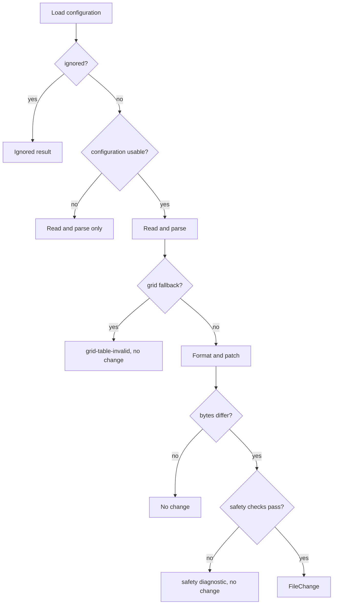

### LintMarkEngine

#### Purpose

`LintMarkEngine` discovers the files selected on the command line, processes them in parallel (configuration, read,
parse, format, and safety checks), optionally writes the rewrites that passed every check, and reports every finding
through the `Context` in a deterministic order. It is the one place where the units of the other subsystems are
combined into the behavior of the tool. Its supporting types `FileResult` and `FileChange` are described in this
document.

#### Data Model

**Rule identifier constants**: `ReadErrorRuleId` (`file-read-error`), `ParseErrorRuleId` (`file-parse-error`),
`FormatErrorRuleId` (`file-format-error`), and `WriteErrorRuleId` (`file-write-error`), taken from `RuleCatalog`. The
encoding and line-ending identifiers come from `SourceDocumentException`; the configuration identifier is
`ConfigLoader.ErrorRuleId` (`config-error`); the safety, grid table, and line-ending identifiers come from
`RuleCatalog` and `DocumentFormatter`.

**_maxDegreeOfParallelism**: `int` — at least one; defaults to the processor count.

**Seams**: `_fileProcessor` (`Func<string, LintMarkConfig?, FileResult>`: the per-file work, given the path and the
configuration the file may be formatted under, null when it must not be formatted), `_documentParser`
(`Func<SourceDocument, ParsedDocument>`: the parse step, also used by the safety checks), `_editorConfigFactory`
(`Func<EditorConfigResolver>`: creates the resolver used by `Run`, by default one that reads the real file system),
`_formatter` (`DocumentFormatter`, by default one with the three block formatters of the `Blocks` subsystem:
`HeadingFormatter`, `CodeBlockFormatter`, and `ThematicBreakFormatter`), and `_fileWriter`
(`Action<string, string, ReadOnlyMemory<byte>, ReadOnlyMemory<byte>>`: path, resolved target captured at the read,
original bytes, new bytes; by default `AtomicFileWriter`). They are supplied through the internal constructor
parameters `fileProcessor`, `documentParser`,
`editorConfigFactory`, `formatter`, and `fileWriter`, and are not user options.

**FileResult**: A sealed record with the constructor `(string path, ImmutableArray<Diagnostic> diagnostics,
LintMarkConfig? config = null)`, which rejects a null or empty path, a default array of diagnostics, and a null
diagnostic, and with the read-only properties `Path` and `Diagnostics` and the init-only properties:

- `Diagnostics`: the findings about the file; empty for a file that was read, parsed, and found compliant. An
  immutable array, so no holder can change it.
- `Config`: the effective configuration of the file (the configuration that applies to it with the line ending filled
  in from the editor settings when the configuration gives none); `null` when the configuration is invalid or has not
  been attached.
- `ConfigErrors`: the configuration problems that apply to the file (`ImmutableArray<ConfigError>`, empty when its
  configuration is valid).
- `Safety`: the `SafetyStatus` of a proposed rewrite that was refused; `Ok` otherwise.
- `Change`: the `FileChange` that is ready to be written; set only for a rewrite that passed every safety check,
  never for a file with an invalid configuration, a format-unsafe document, or a failure.
- `Ignored`: true when an `ignore` pattern skipped the file: it was not read, produced no diagnostic, and is never
  rewritten.

**FileChange**: A sealed record with the constructor `(string originalLf, string newLf, LineEndingInfo
originalEndings, LineEnding targetEnding, ImmutableArray<byte> originalBytes, ImmutableArray<byte> newBytes, string
resolvedTarget)`, which rejects a null text, a default byte array, a line ending that is not defined, and a null or
blank resolved target: the LF-normalized text on disk and after rewriting, the counts of the line terminators on disk,
the line ending to write, the exact bytes the rewrite was computed from, the exact bytes to write (byte order mark and
line endings restored), and the full path of the file the original bytes were read from with symbolic links resolved at
read time. A change exists only for a rewrite that is safe, so nothing downstream can write a refused file by mistake.
The original bytes travel with the change so that the writer can refuse to replace a file that changed after it was
read, and the resolved target travels with them so that the writer can also refuse when a link was redirected to
another file after the read, even when that file holds the same bytes. Its byte arrays are immutable
copies; the equality of two changes compares them by reference, so content is compared through the members.

The instance holds only immutable configuration and stateless collaborators, so `Run` and `Process` can be called
concurrently.

**Diagnostic catalog** of the engine:

- **`file-read-error`** at 1:1: `File not found` (file or directory missing), `Access to the file is denied`, or
  `Cannot read file: {detail}`.
- **`file-encoding-error`** at the first bad byte, or at 1:1 for a UTF-16 or UTF-32 byte order mark: the message
  comes from `SourceDocumentException`.
- **`file-line-ending-error`** at the first bare carriage return: the message comes from `SourceDocumentException`.
- **`file-parse-error`** at 1:1: `Markdown parser failed: {ExceptionType}`.
- **`file-format-error`** at 1:1: `Formatting failed: {ExceptionType}`, or `Formatting failed: the result contains a
  carriage return`.
- **`file-write-error`** at 1:1: `Cannot write file: {detail}`; the other diagnostics of the file are kept.
- **`grid-table-invalid`** at the first border character of the offending line: `Line looks like a grid table border
  but the table is not valid; the file is never rewritten`.
- **`safety-html-mismatch`**, **`safety-structure-mismatch`**, and **`safety-not-idempotent`** at the first line where
  the original and the proposed text differ: a sentence naming the check, the description of the first difference, and
  `the file is not rewritten`.
- **Formatting findings** (from `DocumentFormatter`): `line-ending` at 1:1, and each always-applied formatting rule
  (`trailing-whitespace`, `heading-blank-lines`, and the others of the rule catalog) at the place that its edit changes,
  with the description of the rule as the message.
- **`config-error`** at the position of the problem in the configuration file, with the message of the `ConfigError`
  (see *ConfigLoader Design*), or at 1:1 of the Markdown file with the message `Cannot read .editorconfig settings:
  {detail}` (see *EditorConfigResolver Design*).

Line breaks in messages are replaced by spaces so that a diagnostic is always one line.

#### Key Methods

**Run**: Discovers, processes, optionally rewrites, and reports.

- *Parameters*: `Context context`.
- *Returns*: `void`.
- *Preconditions*: `context` is not null.
- *Postconditions*: every remaining diagnostic and every distinct configuration problem has been written with
  `Context.WriteError`; the exit code is 1 when at least one was reported, and unchanged otherwise; with `Context.Fix`
  every rewrite that passed the checks has been written (or reported as a failed write); with `Context.Diff` the
  unified diff of the proposed rewrites has been written; without `Context.Fix` no file was changed.

Steps: (1) discover the files with `FileDiscovery.DiscoverFiles(context.Paths, current directory)`; (2) select the
configuration sources: a defaults-only loader and no resolver for `--no-config`, a loader for exactly the named file
for `--config`, otherwise a discovering loader; a resolver is created (through the factory) unless `--no-config` was
given; (3) call the `Process` overload that takes the discovered files, the loader, the resolver, and the base
directory; (4) with `--fix`, run the write step; otherwise take every diagnostic of every result; (5) add one
`config-error` diagnostic for every distinct configuration problem (the `ConfigErrors` of all files together with the
loader's initial errors, de-duplicated by value); (6) hand all diagnostics to `TextReporter.Report`; (7) with `--diff`,
hand a `FileDiff` for every result that has a `Change` to `DiffReporter.Report`. Zero matched files is not an error,
and the problems of an explicit configuration file are reported even then.

**Process (files)**: Processes files with the built-in defaults.

- *Parameters*: `IReadOnlyList<string> files`.
- *Returns*: `IReadOnlyList<FileResult>` sorted by path (ordinal).
- *Preconditions*: `files` is not null.

Equivalent to the overload below with a defaults-only loader and no resolver, so no configuration source is read, and
every file is treated as named on the command line.

**Process (files, loader, editorConfig)**: Processes files that were all named explicitly.

- *Parameters*: `IReadOnlyList<string> files`; `ConfigLoader loader`; `EditorConfigResolver? editorConfig` (null
  ignores the editor settings).
- *Preconditions*: `files` (and its elements) and `loader` are not null.

Wraps every path in an explicit `DiscoveredFile` and calls the overload below, so no `ignore` pattern applies.

**Process (files, loader, editorConfig, baseDirectory)**: Processes files and attaches the effective configuration of
each.

- *Parameters*: `IReadOnlyList<DiscoveredFile> files`; `ConfigLoader loader`; `EditorConfigResolver? editorConfig`;
  `string? baseDirectory` (the directory that `ignore` patterns are relative to when no configuration file applies;
  the current directory when null).
- *Returns*: `IReadOnlyList<FileResult>` sorted by path (ordinal).
- *Preconditions*: `files` and `loader` are not null and no file has a null path.

Fixes the base directory once, allocates an array of results, runs `Parallel.For` with `MaxDegreeOfParallelism` set to
the configured limit, and lets every worker call `ProcessFile` and write only its own index. The results are then
ordered by path. A replaced file processor that throws propagates its exception (wrapped in an `AggregateException`
when run in parallel).

**ProcessFile** (private): Handles one file.

- *Steps*: (1) `loader.Load(path)`; (2) when the configuration is valid, the file is not explicit, and
  `FileDiscovery.IsIgnored` matches it (relative to the directory of the configuration file, or the base directory
  for the built-in defaults), return an ignored result without reading the file; (3) when the configuration is
  invalid, run the file processor with a null configuration and attach `Config = null` and the problems as
  `ConfigErrors`; (4) when the configuration has no `EndOfLine` and a resolver is present, `Resolve(path)`: a message
  becomes one `ConfigError` at 1:1 of the Markdown file and the configuration is kept without a line ending, a line
  ending is copied into the configuration with a `with` expression, and otherwise nothing changes; (5) run the file
  processor with the configuration, or with null when there was an editor settings problem, and attach the
  configuration and the problems to its result. The precedence of the line ending is therefore: the `end-of-line` of
  the configuration, then the editor settings, then unspecified (the majority line ending of the file decides later,
  in `DocumentFormatter`).

**ReadAndRewrite** (private): The real file processor. Resolves the path to the full path of the file it finally refers
to (`AtomicFileWriter.ResolveTarget`, following symbolic links) and reads the bytes from that resolved file, so the
identity that is captured is the one the bytes come from (catching `IOException`,
`UnauthorizedAccessException`, `NotSupportedException`, and `SecurityException` as a read failure, which also covers
links that cannot be followed), creates the
`SourceDocument` and parses it (catching `SourceDocumentException` with its precise position, and any other exception
as a parse failure that names only the exception type, so one file's failure never stops the others). A file that must
not be formatted (null configuration) returns an empty result after the read and the parse. Otherwise it calls
`Rewrite` with the resolved target.

**Rewrite** (private): Formats the document and verifies the proposal.

- *Postconditions*: the result has a `Change` only when the proposed rewrite differs from the file and passed every
  safety check.

Steps: (1) a document with a `GridFallback` is never formatted: the result carries only the `grid-table-invalid`
diagnostic, and no change; (2) format with `DocumentFormatter`, apply the edits with `SourcePatcher`, and reject a
result that contains a carriage return; any exception of this step is a `file-format-error`; (3) convert the text to
bytes with the target line ending (`SourceDocument.ToBytes`) and, when the bytes equal the file, return the formatting
diagnostics with no change; (4) run the safety checks for every rewrite that changes bytes: when the text itself changed,
the checks on the LF-normalized text run first, and the rendering of the texts as they are on disk (the original bytes and
the proposed bytes, decoded without the byte order mark, so with the real line endings) always runs, also when only the
line endings change, because the parser renders some text differently for CRLF and LF; a refusal returns the formatting
diagnostics plus the safety diagnostic and the `SafetyStatus`, with no change; (5) otherwise return the formatting
diagnostics and a `FileChange` that carries the resolved target.

**ReportGridFallback** (private): Creates the `grid-table-invalid` diagnostic at the offending position, unless the rule
is switched off in the configuration or suppressed at that offset. Switching the report off never lets the file be
rewritten: the guard of step (1) of `Rewrite` is applied regardless.

**CheckSafety** (private): Runs up to five checks in this order: rendered HTML of the LF-normalized text
(`HtmlEquivalenceChecker.Check`), rendered HTML of the text with the line endings it has on disk
(`HtmlEquivalenceChecker.CheckOnDisk`, on the original and the proposed bytes decoded without the byte order mark),
Pandoc structure (`StructuralTokenChecker`), that the proposed text still parses without the grid table fallback (so an
edit cannot
create a grid-table-looking line that is not a valid table; the proposed text is parsed with the `documentParser`
seam), and idempotency (`IdempotencyChecker` with a delegate that parses, formats, and patches LF-normalized text under
the same configuration). When only the line endings change, the LF-normalized text is unchanged, so only the check
on the text as it is on disk runs; its refusal is reported at line 1, column 1 and says that the line endings are the
cause. The first check that is not equivalent decides: the status is `HtmlMismatch` (for both HTML checks),
`StructureMismatch` (also for the parse check), or `NotIdempotent`, and the diagnostic is placed at the first line where
the original and the proposed text differ. A check that throws is a failed check (fail closed): the exception is
caught around each check, and the problem says `the check failed` and names the exception type. A parser that throws
for the proposed text therefore refuses the rewrite as a structure problem. A parser that throws inside the stability
check is converted by `IdempotencyChecker` itself, so it refuses the rewrite as not stable.

**WriteChanges** (private): The write step of `--fix`. For each result in path order: a result without a `Change`
keeps its diagnostics; otherwise call the file writer with the resolved target captured at the read, the original bytes,
and the new bytes. On success the Formatting
diagnostics of the file are dropped (rewriting removed them); on any exception (including the writer's refusal of a
file that changed or a link that was redirected after the read) all diagnostics of the file stay and a
`file-write-error` is added. A failure never stops the other files. It runs on the calling thread after every worker
has finished.

The per-file pipeline, in order:

#### Error Handling

Per-file failures are data, not exceptions, and are reported through `TextReporter`. Configuration problems are data
too: the loader and the resolver never throw for environment or content problems, so an invalid configuration never
stops the other files, and never stops the file it applies to from being read and parsed. Every exception of the
formatting step and of every safety check is caught and becomes a diagnostic (`file-format-error`, or a failed check),
so no broken formatter or checker can let a rewrite through or stop the run. A failed write is a `file-write-error`
diagnostic and leaves the file as it was. Argument errors raise `ArgumentNullException`, and a degree of parallelism
below one raises `ArgumentOutOfRangeException`. An empty path argument raises `ArgumentException` from discovery;
because nothing is written or reported until after processing, nothing has been written when that happens, and
`Program.Main` reports it as an error. An explicit `--config` file is read when the loader is created, before
processing starts; its problems do not raise but are reported with the others.

Workers never write output, never write files, and never touch the `Context`; this is the thread-safety rule that
makes the output and the files written deterministic (see the *LintMark* system design).

#### Dependencies

- **Context** — path, configuration, fix, and diff options in; reports out.
- **FileDiscovery** — file selection and the `ignore` decision.
- **SourceDocument** and **DocumentParser** — decoding and parsing of each file, and the byte conversion of the result.
- **ConfigLoader** and **ConfigLoadResult** — the configuration that applies to each file and its problems.
- **EditorConfigResolver** and **EditorConfigResult** — the line ending from the editor settings.
- **LintMarkConfig** and **ConfigError** — the effective configuration and the problem entries it carries.
- **DocumentFormatter**, **FormatResult**, and **SourcePatcher** — the proposed rewrite.
- **HeadingFormatter**, **CodeBlockFormatter**, and **ThematicBreakFormatter** (`Blocks` subsystem) — the block
  formatters that the default `DocumentFormatter` is created with.
- **HtmlEquivalenceChecker**, **StructuralTokenChecker**, **IdempotencyChecker**, **EquivalenceResult**, and
  **SafetyStatus** — the safety checks and their outcome.
- **AtomicFileWriter** — the write.
- **TextReporter**, **DiffReporter**, and **FileDiff** — the output.
- **Diagnostic** and **RuleCatalog** — the findings and their identifiers.

#### Callers

- **Program** — `Run` calls `Run(context)` on an engine with the default settings.
